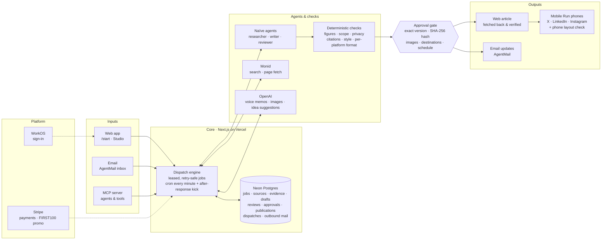

# FounderDesk

**Your notes in. A week of founder content out.**
Drop in rough notes, a voice memo or just your website. FounderDesk understands your domain expertise, researches the argument, writes it in your voice, holds every number to its source, and turns the approved article into a blog post, newsletter, X thread, LinkedIn post and Instagram carousel. It publishes only the exact version you approved, verifies the live page, and posts from your own accounts through a real phone.

Built by **Ankit, Amy and Megan**. Live at **[founderdesk.vercel.app](https://founderdesk.vercel.app)**. First article free.

**Proof it runs end to end:** [this post on X](https://x.com/Aubric_Inc/status/2119500912993423635) was published autonomously by a Mobile Run phone, and its link was read back and verified before it counted as published.

## Architecture



| Layer | What it does | Where |
|---|---|---|
| Inputs | Founders start from the one-box composer (notes, links, website, voice), by email, or from an MCP client | `src/app/start`, `src/app/api/webhooks/agentmail`, `src/app/api/mcp` |
| Dispatch engine | Every step is a durable job: leased with `FOR UPDATE SKIP LOCKED`, idempotent request keys, compare-and-set stage changes | `src/lib/workflow/engine.ts`, `run.ts` |
| Record | Neon is the source of truth; nothing depends on an agent's chat history | `src/lib/db/schema.ts`, `drizzle/` |
| Agents | Naïve sessions with structured outputs; Monid for search and fetch; OpenAI for transcription, images and idea suggestions | `src/lib/workflow/handlers.ts`, `src/lib/integrations/*`, `src/lib/ideas.ts` |
| Checks | Deterministic guardrails can only make the reviewer stricter: figures, scope, privacy, citations, AI-slop style, per-platform format | `src/lib/workflow/editorial.ts`, `humanize.ts` |
| Approval gate | Approval binds the version, its SHA-256 hash, chosen images, destinations and schedule | `src/lib/workflow/publish.ts` |
| Outputs | Web article verified by fetching it back; Mobile Run phones post to X, LinkedIn and Instagram and must report a real post link; per-channel scheduling | `publish.ts`, `scheduler.ts`, `src/lib/integrations/mobilerun.ts` |
| Platform | WorkOS sign-in (email code, Google, SSO) on our own screens; Stripe Checkout with the FIRST100 launch code | `src/lib/workos-headless.ts`, `src/lib/integrations/stripe.ts` |

## Run it

```bash
pnpm install
pnpm dev                    # http://localhost:3000 — no keys needed
pnpm test                   # 140+ tests, parallel across all cores, real Postgres via PGlite
pnpm build
```

With no credentials every integration runs as a **labelled simulation** (never a silent fake). The operator desk at `/desk` has an inbound-email simulator prefilled with the demo brief. Delivering it walks the whole spec:

1. **A — intake.** Job created from the email (thesis, audience, links, boundaries, private names) plus a fixed-scope acknowledgement with a Checkout link.
2. **B — payment.** Idempotent fulfillment moves the paid order straight into research.
3. **C — research.** Attachment and links fetched; only passages that appear verbatim in a source are kept as evidence.
4. **D — write and review.** The reviewer catches *80% in the notes vs 60% in the pilot report* and *"all companies" vs 42 B2B SaaS companies*.
5. **E — clarification.** The founder is asked by email. An unrelated reply keeps the job waiting; a real answer resumes it.
6. **F — approval.** Approval is bound to the draft version, its SHA-256 content hash and the destination.
7. **G — publish.** The live page is fetched back and must carry the approved hash; the URL is emailed.
8. **H — phone check.** The published article is checked as it renders on a phone.

## Studio

Signed-in founders get a workspace at `/studio` (sign up at `/signup` with email or Google; in development, "Open the demo workspace" seeds a sample founder and runs a real article through the pipeline):

- **Onboarding**: paste a website, upload a company PDF or paste text; the brand (name, tagline, products, audience, key terms, colours, logo) and a first voice profile are captured.
- **Brand & voice**: writing samples teach a measurable voice profile; style guide (preferred terms, banned phrases, tone, formatting); audience personas.
- **Knowledge & memory**: company facts, products, opinions, earlier articles and approved sources become citable sources in research. Corrections like "use teams instead of customers" are remembered and applied to every later article.
- **Agent desk**: Researcher, Writer, Editor, Fact-checker and Reviewer each log what they did; custom agents run saved workflows on a cadence and fill the calendar.
- **Quality score** on every reviewed draft (accuracy, sources, originality, voice match, readability, search) and in the approval email.
- **Highlight & ask** on the review page: select a passage, say what to change; the new version goes back through fact-check.
- **Version history** with diffs, **calendar**, **insights** (first-party views and reads, next topics, refresh candidates, AI-search readiness), **Idea Lab** (Viral Twin, Audience Reaction Panel, Historical Analogs, Hook Tournament, Trend Timing Radar, Controversy vs. Credibility, fed by your post history and a swipe file captured with a bookmarklet).
- **Connections**: X, LinkedIn and Instagram via OAuth with auto-post (approval still required); WordPress, Ghost and Webflow publishing.

Test payments: `/test-payment` has Stripe's test card, a bookmarklet and a Chrome extension that fills Stripe Checkout in test mode (`cs_test_` sessions only).

## Go live

Copy `.env.example` to `.env.local` and fill in what you have. Each integration switches from simulated to live independently; `/status` shows which is which.

| Integration | Needs | Setup |
|---|---|---|
| Neon | `DATABASE_URL` | `pnpm db:migrate` |
| Stripe | `STRIPE_SECRET_KEY`, `STRIPE_WEBHOOK_SECRET` | webhook → `/api/webhooks/stripe` (`checkout.session.completed`, `checkout.session.async_payment_succeeded`) |
| AgentMail | `AGENTMAIL_API_KEY` | `pnpm setup:agentmail` creates the inbox + webhook, prints `AGENTMAIL_INBOX_ID` / `AGENTMAIL_WEBHOOK_SECRET` |
| Naïve | `NAIVE_API_KEY` | agents are created on first use (idempotent) and stored in `app_settings` |
| Monid | `MONID_API_KEY` | `pnpm setup:monid` runs discover → inspect; pick real endpoints, then `--try` them |
| Mobile Run | `MOBILERUN_API_KEY`, `MOBILERUN_DEVICE_ID` | founders sign in to X, LinkedIn and Instagram on the phone, then link them with **Check phone** on `/studio/connections` |
| WorkOS | `WORKOS_API_KEY`, `WORKOS_CLIENT_ID`, `WORKOS_COOKIE_PASSWORD` (32+ chars) | register `${APP_URL}/auth/callback` and `${APP_URL}/auth/oauth/callback`; enable Magic Auth and Google |
| OpenAI | `OPENAI_API_KEY` | voice-memo transcription, images, idea suggestions |
| MCP | `MCP_API_KEY` | see `/desk/connect` (Claude Code, Muse via `mcp-remote`) |

Production also requires `APP_SECRET` (signs private links), `DESK_TOKEN` (operator desk) and `CRON_SECRET` (auth for the `/api/cron/tick` backstop). `vercel.json` runs the backstop every minute (Vercel Pro); after any action the app also keeps the order moving for about a minute, so steps and their emails land within seconds. On the Hobby plan, set it to daily and rely on webhooks and open pages to drive the queue.

## How it stays correct

- **Neon is the record.** Nothing depends on an agent's conversation history: `jobs`, `sources`, `evidence`, `drafts`, `reviews`, `approvals`, `publications`, `provider_events`, `dispatches`, `outbound_messages`.
- **Safe retries.** The sequence is always: receive → verify → persist event + next task → start remote work → record its ID → handle the result.
  - Every dispatch has a stable request key, which is also the provider idempotency key. The key changes only when a remote run definitively failed.
  - Workers lease rows with `FOR UPDATE SKIP LOCKED`, so webhooks, cron and open pages can all drive work concurrently.
- **Stage changes are compare-and-set.** Concurrent workers can't double-advance a job, double-charge or double-email.
- **Structured results are validated.** Every agent result is checked against the zod schema it was given. An idle Naïve session only counts as finished with `stop_reason: end_turn` and a valid structured result. A completed Monid run only counts if it returned usable text. A Mobile Run task only counts if it succeeded and returned output.
- **Guardrails can only make the reviewer stricter.** Deterministic checks for figures, scope, private names and citations run on every review, live or simulated.
- **Bounded loops.** At most 2 automatic revision cycles. Writing in a founder's answer is a separate, free pass.
- **Publish gate.** Publishing requires all of: paid; current draft == reviewed draft; no unresolved blocking findings; approval matches the content hash and destination; not already published.
- **Social posts aren't idempotent.** A `publishing` row is written before posting. A retry that finds it without an external ID stops for a human instead of double-posting.

## Design

The visual language follows Profound's marketing site as curated on Mobbin, retrieved through the Mobbin MCP:
- **Shell and type:** black canvas, hairline borders, dashed column guides, Inter at weight 500 with tight tracking.
- **Section patterns:** the perspective-grid hero with a glowing orb, the orange announcement pill, `[01]` mono step labels, and the four-cell feature grid.

App screens use Mobbin patterns Profound doesn't have: a document-plus-details-rail review page with a pinned approve action (Aboard, Mercury) and a vertical order timeline (Hers, Fiverr). Brand, copy and product are FounderDesk's own.

## Honest limits

- **Simulated mode.** The local editorial engine is deterministic and template-shaped. It exists to exercise the workflow, not to write like an agent. Real prose comes from the Naïve agents.
- **What has run live.** Naïve, Monid, AgentMail, OpenAI, WorkOS, Stripe (sandbox) and Mobile Run have all run against live accounts; Mobile Run posted [this X post](https://x.com/Aubric_Inc/status/2119500912993423635) on its own. LinkedIn and Instagram posting through the phone use the same code path but haven't been run live yet.
- **Email limits.** New AgentMail accounts may email 10 recipients in their first day and 25 in their first week; rate-limited mail stays queued and retries after the reset.
- **AgentMail webhook payload.** Fields like `from` and `thread_id` are parsed defensively because the docs show them only partially. Confirm against a real delivery.
- **TikTok.** Designed but not built: it needs a video step and an app audit.
- **Founder-supplied URLs.** They go through an SSRF guard (private, loopback and link-local addresses are refused), but DNS rebinding is not mitigated.
